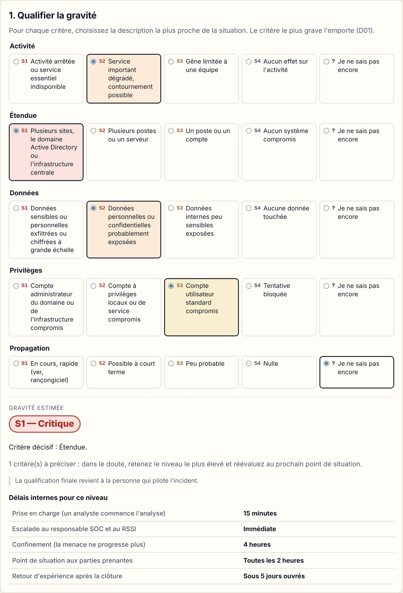
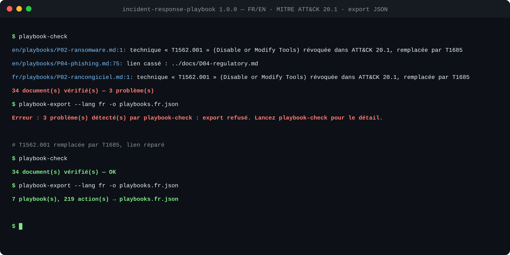
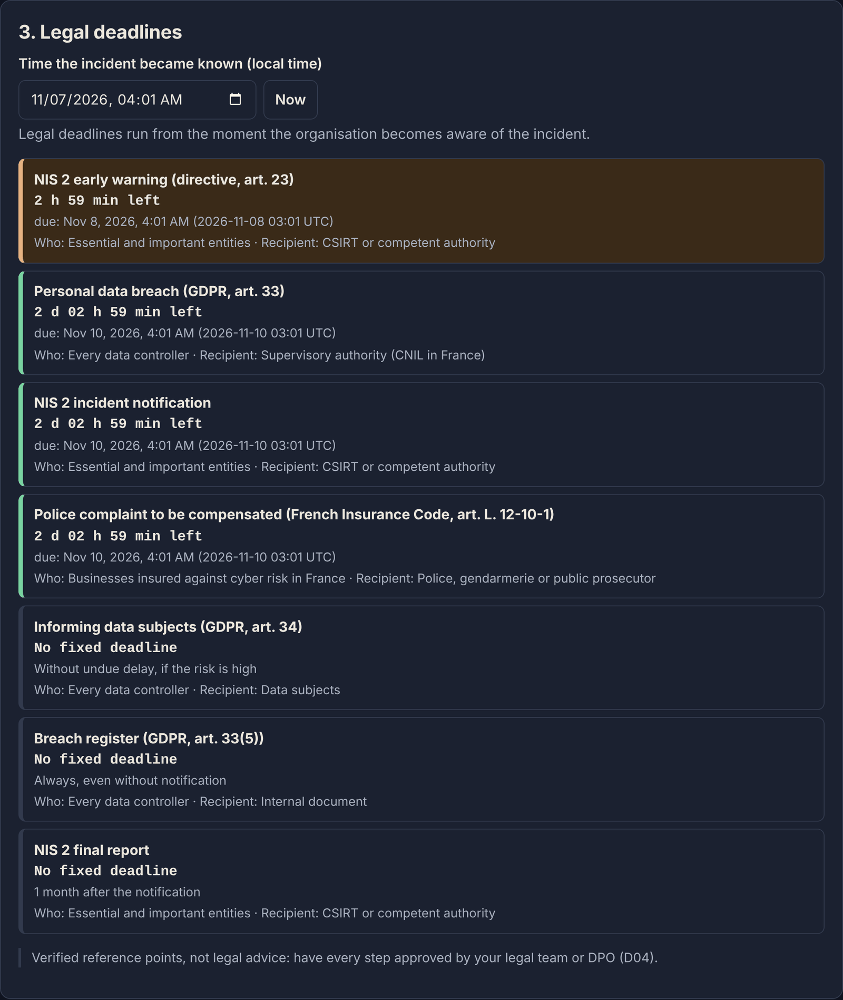

# Playbook de réponse aux incidents

[](https://github.com/Aiyeesha/incident-response-playbook/actions/workflows/checks.yml)


🇬🇧 [English version](README.md)

Procédures de réponse aux incidents de cybersécurité, **directement utilisables par une équipe** :
pour chaque type d'incident, qui fait quoi, dans quel ordre, avec quelles preuves à préserver
et quelles obligations à respecter.

**v1.1.0** — 7 playbooks, 6 documents de référence, 4 modèles, en français et en anglais, vérifiés en CI,
et une **[interface web](https://aiyeesha.github.io/incident-response-playbook/?lang=fr)** pour les premières heures d'un incident.



## Ce que contient le dépôt

| Dossier | Contenu |
|---|---|
| [`fr/`](fr/) · [`en/`](en/) | La documentation complète, en français et en anglais |
| `…/playbooks/` | P01 à P07 : procédures pas à pas, par type d'incident |
| `…/docs/` | Gravité et délais, escalade, matrice RACI, cadre réglementaire, preuves, exercice sur table |
| `…/templates/` | Rapport d'incident, post-mortem, communication de crise, registre de preuves |
| [`src/playbook_tools/`](src/playbook_tools/) | Outil de vérification `playbook-check` et export JSON `playbook-export` |

## Référentiels

- **NIST SP 800-61 Rev. 3** (avril 2025), recommandations de réponse aux incidents alignées sur le
  **NIST Cybersecurity Framework 2.0** ; elle remplace la révision 2 de 2012.
- **MITRE ATT&CK** pour décrire les techniques d'attaque de chaque playbook.
- Contexte français : guides de l'**ANSSI** et du **CERT-FR**, **Cybermalveillance.gouv.fr**,
  **RGPD** (articles 33 et 34) et directive **NIS 2**.

## Feuille de route

| Étape | Contenu | État |
|---|---|---|
| 1 | Dépôt, structure, vérification automatique en CI | ✅ |
| 2 | Socle commun : gravité et délais, escalade, RACI, cadre réglementaire, preuves | ✅ |
| 3 | Playbooks P01 à P03 : logiciel malveillant, rançongiciel, fuite de données | ✅ |
| 4 | Playbooks P04 à P07 : hameçonnage, accès non autorisé, déni de service, compte compromis | ✅ |
| 5 | Modèles et exercice sur table | ✅ |
| 6 | Version anglaise complète | ✅ |
| 7 | Export JSON des listes d'actions → **v1.0.0** | ✅ |
| 8 | Interface web sur GitHub Pages : triage, échéances légales, actions, rapport → **v1.1.0** | ✅ |

## Le format d'un document

Chaque document commence par une **fiche** entre deux lignes `---`, que GitHub affiche sous forme
de tableau et que `playbook-check` vérifie :

```yaml
---
id: P02                     # P = playbook, D = document de référence, T = modèle
lang: fr                    # doit correspondre au dossier fr/ ou en/
title: Attaque par rançongiciel
severity: [S1]              # playbooks : gravités possibles, de S1 (critique) à S4 (faible)
mitre: [T1486, T1490]       # playbooks : techniques MITRE ATT&CK
owner: Responsable SOC      # playbooks : responsable de la procédure
review: 2026-11-07          # date de dernière révision (AAAA-MM-JJ)
---
```

Le format accepté est un **sous-ensemble strict** de YAML (`clé: valeur` et `clé: [a, b]`) : tout le
reste est refusé avec un message clair, pour éviter les pièges de YAML complet.

`playbook-check` vérifie aussi :

- que chaque document existe **dans les deux langues**, avec les mêmes gravités et techniques MITRE ;
- que chaque technique MITRE ATT&CK **existe et est active** dans la version officielle embarquée
  (une technique révoquée est signalée avec son remplaçant) et qu'elle est **expliquée dans le texte** ;
- que chaque playbook a ses **8 sections numérotées**, dans l'ordre, avec des actions à cocher ;
- qu'**aucun lien interne n'est cassé**.

La liste des techniques est extraite des données officielles de MITRE par
`python scripts/update_attack_data.py`, à relancer à chaque nouvelle version d'ATT&CK
(version actuelle : **20.1**).

Ci-dessous, une exécution réelle : une technique révoquée et un lien cassé sont signalés, l'export JSON
est refusé, puis tout passe une fois corrigé.



```powershell
python -m venv .venv
.\.venv\Scripts\Activate.ps1
pip install -e ".[dev]"
playbook-check          # vérifie la documentation
playbook-export --lang fr -o playbooks.fr.json   # exporte les actions à cocher
pytest -v               # teste les outils
```

## Export JSON

`playbook-export` transforme la documentation d'une langue en un document JSON structuré, prêt à
être chargé dans un outil de ticketing, un tableau de bord SOC ou un suivi d'incidents :

- les **playbooks** : métadonnées, paragraphe « Quand l'utiliser », noms officiels des techniques
  MITRE ATT&CK et **actions à cocher regroupées par section** ;
- la **grille de gravité** et les **délais internes** de [D01](fr/docs/D01-gravite-et-delais.md) ;
- les **obligations légales** de [D04](fr/docs/D04-cadre-reglementaire.md), avec leur délai en heures
  quand il est chiffré (`hours`), pour calculer les échéances.

Ces données sont **lues dans les tableaux Markdown**, qui restent la seule source de vérité ;
`playbook-check` vérifie leur forme et leur parité FR/EN. L'export est **refusé** si `playbook-check`
trouve le moindre problème : une liste incomplète n'est jamais diffusée. Les deux fichiers sont joints
à chaque [version publiée](https://github.com/Aiyeesha/incident-response-playbook/releases).

```powershell
playbook-export --lang fr -o playbooks.fr.json
```

```json
{
  "schema_version": 2,
  "tool_version": "1.1.0",
  "attack_version": "20.1",
  "lang": "fr",
  "severity": {
    "levels": [{ "id": "S1", "label": "Critique" }, "…"],
    "criteria": [{ "name": "Activité", "levels": { "S1": "Activité arrêtée…", "S2": "…" } }],
    "timelines": [{ "name": "Prise en charge", "levels": { "S1": "15 minutes", "S2": "1 heure" } }],
    "source": "fr/docs/D01-gravite-et-delais.md"
  },
  "obligations": {
    "items": [{ "name": "Violation de données personnelles (RGPD, art. 33)", "hours": 72, "…": "…" }],
    "source": "fr/docs/D04-cadre-reglementaire.md"
  },
  "playbooks": [
    {
      "id": "P02",
      "title": "Attaque par rançongiciel",
      "severity": ["S1"],
      "when": "des fichiers sont chiffrés, une note de rançon apparaît…",
      "mitre": [{ "id": "T1486", "name": "Data Encrypted for Impact" }],
      "source": "fr/playbooks/P02-rancongiciel.md",
      "sections": [
        { "number": 3, "title": "Confinement", "actions": ["Isoler toutes les machines touchées…"] }
      ]
    }
  ]
}
```

## Interface web

**[Ouvrir l'interface](https://aiyeesha.github.io/incident-response-playbook/?lang=fr)** — le dossier [`web/`](web/) contient une interface pour le
moment où un incident commence, qui fonctionne entièrement dans le navigateur :

1. **qualifier la gravité** sur les cinq critères de D01 (le critère le plus grave l'emporte ; un
   playbook peut relever le niveau, jamais l'abaisser) et afficher les délais internes du niveau ;
2. **choisir le playbook** grâce à son paragraphe « Quand l'utiliser » ;
3. **suivre les échéances légales** de D04 depuis l'heure de prise de connaissance (CNIL 72 h,
   NIS 2 24 h et 72 h, plainte 72 h) ;
4. **cocher les actions** des huit phases, chacune horodatée ;
5. **exporter un rapport Markdown** (heures en UTC), à reprendre dans le rapport d'incident (T01).



Elle lit les exports JSON de cette documentation, en français et en anglais, régénérés à partir du
même commit à chaque publication (`.github/workflows/pages.yml`). Choix de sécurité :
politique de sécurité du contenu stricte (aucune requête hors du site), aucun cookie ni mesure
d'audience, **rien n'est conservé par défaut** ; l'enregistrement local est une option à activer.
La qualification proposée reste une **aide à la décision**.

```powershell
# Prérequis : Node.js 24 et l'outil Python installé (voir plus haut)
playbook-export --lang fr -o web/data/playbooks.fr.json
playbook-export --lang en -o web/data/playbooks.en.json
cd web
npm ci                 # dépendances de développement, versions exactes
npm test               # tests (dont les vrais exports de web/data/)
npm run build          # compile src/*.ts vers dist/
python -m http.server 8000   # puis ouvrir http://localhost:8000
```

## Licence

[MIT](LICENSE) © Aïcha Imène Dahoumane — libre d'adaptation pour votre organisation.
