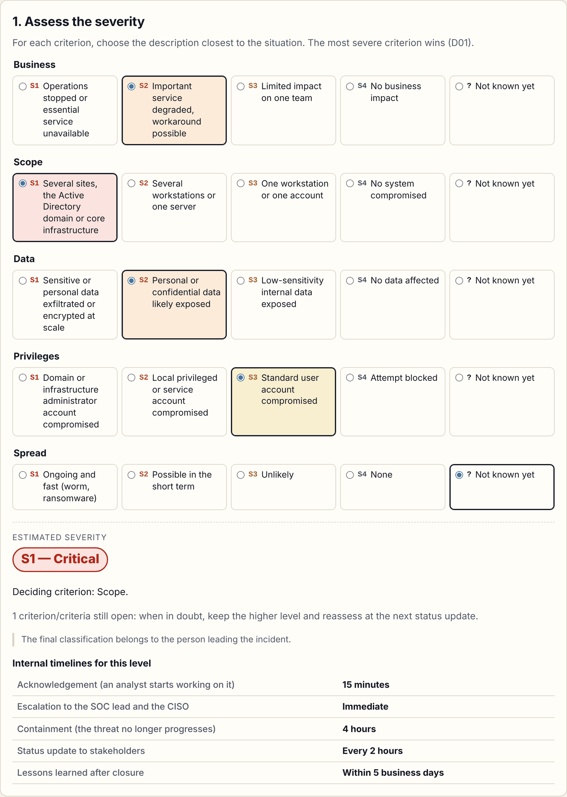
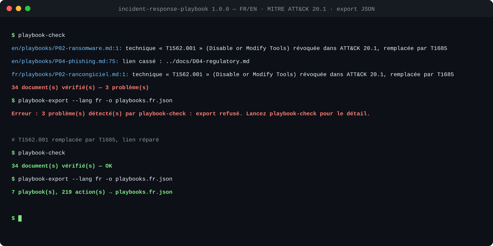
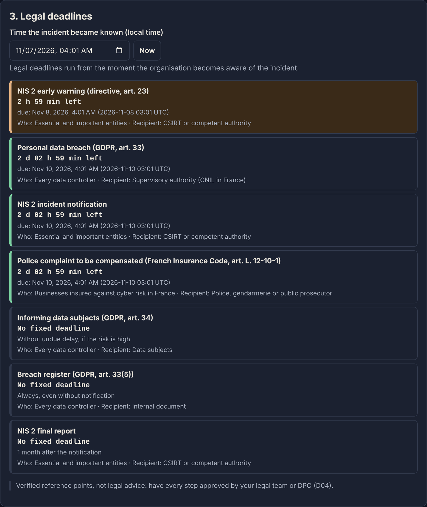

# Incident Response Playbook

[](https://github.com/Aiyeesha/incident-response-playbook/actions/workflows/checks.yml)


🇫🇷 [Version française](README.fr.md)

Cybersecurity incident response procedures **a team can use as-is**: for each incident type,
who does what, in which order, which evidence to preserve and which obligations apply.

**v1.1.0** — 7 playbooks, 6 reference documents, 4 templates, in French and English, checked in CI,
and a **[web interface](https://aiyeesha.github.io/incident-response-playbook/)** for the first hours of an incident.



## What the repository contains

| Folder | Content |
|---|---|
| [`fr/`](fr/) · [`en/`](en/) | The full documentation, in French and English |
| `…/playbooks/` | P01 to P07: step-by-step procedures per incident type |
| `…/docs/` | Severity and timelines, escalation, RACI matrix, regulatory context, evidence, tabletop exercise |
| `…/templates/` | Incident report, post-mortem, crisis communication, evidence log |
| [`src/playbook_tools/`](src/playbook_tools/) | `playbook-check` validation tool and `playbook-export` JSON export |

## Frameworks

- **NIST SP 800-61 Rev. 3** (April 2025), incident response recommendations aligned with the
  **NIST Cybersecurity Framework 2.0**; it supersedes Rev. 2 (2012).
- **MITRE ATT&CK** to describe the attack techniques of each playbook.
- French context: **ANSSI** and **CERT-FR** guidance, **Cybermalveillance.gouv.fr**,
  **GDPR** (articles 33 and 34) and the **NIS 2** directive.

## Roadmap

| Step | Content | Status |
|---|---|---|
| 1 | Repository, layout, automated checks in CI | ✅ |
| 2 | Common foundation: severity and timelines, escalation, RACI, regulatory context, evidence | ✅ |
| 3 | Playbooks P01 to P03: malware, ransomware, data breach | ✅ |
| 4 | Playbooks P04 to P07: phishing, unauthorised access, denial of service, compromised account | ✅ |
| 5 | Templates and tabletop exercise | ✅ |
| 6 | Full English version | ✅ |
| 7 | JSON export of the action checklists → **v1.0.0** | ✅ |
| 8 | Web interface on GitHub Pages: triage, legal deadlines, checklist, report → **v1.1.0** | ✅ |

## Document format

Each document starts with a **front matter** block between two `---` lines, rendered by GitHub as a
table and validated by `playbook-check`:

```yaml
---
id: P02                     # P = playbook, D = reference document, T = template
lang: en                    # must match the fr/ or en/ folder
title: Ransomware attack
severity: [S1]              # playbooks: possible severities, from S1 (critical) to S4 (low)
mitre: [T1486, T1490]       # playbooks: MITRE ATT&CK techniques
owner: SOC lead             # playbooks: procedure owner
review: 2026-11-07          # last review date (YYYY-MM-DD)
---
```

The accepted format is a **strict subset** of YAML (`key: value` and `key: [a, b]`): anything else is
rejected with a clear message, to avoid the pitfalls of full YAML.

`playbook-check` also verifies:

- that every document exists **in both languages**, with the same severities and MITRE techniques;
- that every MITRE ATT&CK technique **exists and is active** in the bundled official version (a revoked
  technique is reported with its replacement) and is **explained in the text**;
- that every playbook has its **8 numbered sections**, in order, with checklist actions;
- that **no internal link is broken**.

The technique list is extracted from MITRE's official data by `python scripts/update_attack_data.py`,
to be rerun for every new ATT&CK release (current version: **20.1**).

Below, a real run: a revoked technique and a broken link are reported, the JSON export is refused,
then everything passes once fixed (the tool messages are in French).



```powershell
python -m venv .venv
.\.venv\Scripts\Activate.ps1
pip install -e ".[dev]"
playbook-check          # validate the documentation
playbook-export --lang en -o playbooks.en.json   # export the checklists
pytest -v               # test the tools
```

## JSON export

`playbook-export` turns the documentation of one language into a structured JSON document, ready to
be loaded into a ticketing tool, a SOC dashboard or an incident tracker:

- the **playbooks**: metadata, "When to use it" paragraph, official MITRE ATT&CK technique names
  and **checklist actions grouped by section**;
- the **severity grid** and **internal timelines** of [D01](en/docs/D01-severity-and-timelines.md);
- the **legal obligations** of [D04](en/docs/D04-regulatory-context.md), with their deadline in hours
  when it is a fixed number (`hours`), to compute due dates.

This data is **read from the Markdown tables**, which remain the single source of truth;
`playbook-check` verifies their shape and their FR/EN parity. The export is **refused** if
`playbook-check` finds any problem, so an incomplete list is never distributed. Both files are
attached to every [release](https://github.com/Aiyeesha/incident-response-playbook/releases).

```powershell
playbook-export --lang en -o playbooks.en.json
```

```json
{
  "schema_version": 2,
  "tool_version": "1.1.0",
  "attack_version": "20.1",
  "lang": "en",
  "severity": {
    "levels": [{ "id": "S1", "label": "Critical" }, "…"],
    "criteria": [{ "name": "Business", "levels": { "S1": "Operations stopped…", "S2": "…" } }],
    "timelines": [{ "name": "Acknowledgement", "levels": { "S1": "15 minutes", "S2": "1 hour" } }],
    "source": "en/docs/D01-severity-and-timelines.md"
  },
  "obligations": {
    "items": [{ "name": "Personal data breach (GDPR, art. 33)", "hours": 72, "…": "…" }],
    "source": "en/docs/D04-regulatory-context.md"
  },
  "playbooks": [
    {
      "id": "P02",
      "title": "Ransomware attack",
      "severity": ["S1"],
      "when": "files are encrypted, a ransom note appears…",
      "mitre": [{ "id": "T1486", "name": "Data Encrypted for Impact" }],
      "source": "en/playbooks/P02-ransomware.md",
      "sections": [
        { "number": 3, "title": "Containment", "actions": ["Isolate every affected machine…"] }
      ]
    }
  ]
}
```

## Web interface

**[Open the interface](https://aiyeesha.github.io/incident-response-playbook/)** — the [`web/`](web/) folder holds an interface for the moment an
incident starts, running entirely in the browser:

1. **assess the severity** on the five criteria of D01 (the most severe criterion wins; a playbook
   can raise the level, never lower it) and show the internal timelines for that level;
2. **pick the playbook** using its "When to use it" paragraph;
3. **track the legal deadlines** of D04 from the time the incident became known (CNIL 72 h,
   NIS 2 24 h and 72 h, police complaint 72 h);
4. **tick the actions** of the eight phases, each one timestamped;
5. **export a Markdown report** (times in UTC), to reuse in the incident report (T01).



It reads the JSON exports of this documentation, in French and English, regenerated from the same
commit at every publication (`.github/workflows/pages.yml`). Security choices: strict
content security policy (no request outside the site), no cookies or analytics, **nothing is kept
by default**; local saving is an opt-in option. The proposed severity remains a **decision aid**.

```powershell
# Requirements: Node.js 24 and the Python tool installed (see above)
playbook-export --lang en -o web/data/playbooks.en.json
playbook-export --lang fr -o web/data/playbooks.fr.json
cd web
npm ci                 # development dependencies, exact versions
npm test               # tests (including the real exports in web/data/)
npm run build          # compiles src/*.ts into dist/
python -m http.server 8000   # then open http://localhost:8000
```

## License

[MIT](LICENSE) © Aïcha Imène Dahoumane — free to adapt for your organisation.
